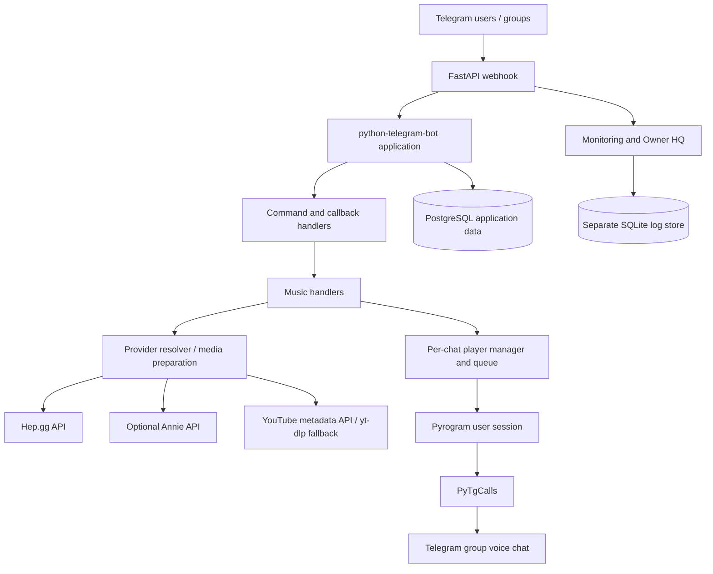

<div align="center">

<p align="center">
  <strong>·  ·  ·  ·  ·  ·  ·  ·  ·  ·  ·  ·  ·  ·  ·  ·  ·  ·</strong><br>
  
</p>


# Muichiro X Music

<h1 align="center">
    
  </h1>

**A Telegram music and community bot wrapped in the calm atmosphere of the Mist Hashira.**

[](https://www.python.org/)
[](https://t.me/NyxLuciferX02)
[](https://docs.pyrogram.org/)
[](https://www.postgresql.org/)
[](https://www.docker.com/)

*Music through the mist. Community beyond the clouds.*

</div>

<p align="center">
  <strong>·  ·  ·  ·  ·  ·  ·  ·  ·</strong><br>
  
</p>


---

## 霧 · About

**Muichiro** is a multi-feature Telegram bot whose active application combines music playback in Telegram group voice chats with community utilities, interactive games, Demon Slayer Hunt, welcome tools, and AI-powered text features.

The music subsystem can search for tracks, prepare audio, deliver audio in Telegram, and stream audio/video into group voice chats through a separate Pyrogram user session and PyTgCalls. A per-chat player manager maintains playback state and queues. Interactive player messages expose playback controls.

The repository also contains a FastAPI webhook service, a PostgreSQL-backed application data layer, and a separately stored SQLite monitoring dashboard.

> This README documents the code in this repository snapshot. It does not imply that every optional provider or deployment integration is configured on a live bot.

<h1 align="center">
    
  </h1>

## ✦ Feature map

### Music & voice chat

- Search the configured music provider by track query, or resolve supported media URLs.
- Play audio in Telegram voice chats; send audio files directly in Telegram.
- Video retrieval and voice-chat video playback paths are implemented separately.
- Per-chat queue and player state, next-track advancement, and stream-end handling.
- Audio player controls: pause/resume, skip, stop, queue view, and 10-second rewind/forward.
- Save up to 10 personal favourites, remove favourites, and play saved tracks.
- Track metadata and artwork/thumbnail handling.
- Music provider selection between **Hep.gg** (default) and the optional **Annie** provider.
- Music commands and privileged player actions are registered in `music/handlers.py`.

### Community & moderation

- Welcome messages with configurable text/media settings.
- Group member, bot membership, group, and daily activity tracking.
- Admin utilities for ban, mute, unmute, unban, promote, demote, and admin listing.
- Group tagging with a stop command.
- Sticker responses and user/chat ID lookup.

### Games & Demon Slayer Hunt

- Tic-Tac-Toe, Rock Paper Scissors, UNO, Connect 4, and Chess.
- Separate bot-opponent variants for Tic-Tac-Toe, Rock Paper Scissors, Connect 4, and Chess.
- Demon Slayer Hunt with timed group hunts, character guessing, hints, points, profiles, ranks/leaderboards, achievements, badges, store, and inventory.
- Mystery member selection and guess/reveal commands.

### AI & utilities

- Groq-backed chat/answer-solving and translation handlers.
- Personality and mood controls, plus chat reset.
- Time and weather commands (weather requires an OpenWeatherMap API key).
- Group/user summaries and owner broadcast tooling.

### Operations & observability

- FastAPI webhook endpoint and health checks.
- PostgreSQL connection retry/reconnect handling.
- Music, bot activity, and application log capture in a separate SQLite monitoring database.
- HTTP Basic-auth protected monitoring dashboard and Owner HQ endpoints.
- Docker image includes FFmpeg and Stockfish.

## 🎧 Music player

The player interface is generated in `music/ui.py` and managed by `music/handlers.py`.

| Control | Behaviour |
|---|---|
| Progress line | Displays elapsed time, a progress indicator, and duration |
| Pause / Resume | Toggles the active voice-chat stream |
| Skip | Advances to the next queued track |
| Stop | Stops playback and clears the current player state |
| Queue | Sends the current queue |
| Rewind / Forward | Seeks by 10 seconds for audio playback |
| Favourite | Saves the current audio track to the user's favourites |

The player hides seek and favourite controls for video mode. Privileged actions are checked against the chat's admin status. The source tree contains artwork/templates, but **no dedicated screenshots of the live music player** were included in the supplied archive, so none are fabricated here.

<p align="center">
  <strong>·  ·  ·  ·  ·  ·  ·  ·  ·</strong><br>
  
</p>


## ⌘ Commands

Commands below are taken from handlers registered by the active `bot.py` and `music/handlers.py`. Some commands are restricted by role or context; Telegram command-menu entries are a smaller subset of all registered commands.

### Music

| Command | Purpose |
|---|---|
| `/play <query>` | Start or queue voice-chat music |
| `/audio <query>` | Retrieve a song as an audio file |
| `/video <query>` | Retrieve video media |
| `/vplay <query>` | Start video playback in voice chat |
| `/musicconnection` | Change the global music provider |
| `/queue` | Show the queue |
| `/now` | Show the current player |
| `/skip` | Skip the current track |
| `/pause` | Pause playback |
| `/resume` | Resume playback |
| `/loop` | Toggle loop mode |
| `/stop` | Stop playback and clear the queue |
| `/fav` | List your saved favourite tracks |
| `/delfav <number>` | Remove a favourite |
| `/playfav <number>` | Play a saved favourite |

The interactive player also provides callback controls. The exact provider availability depends on the corresponding API credentials.

### Main, AI & utility

| Command | Purpose |
|---|---|
| `/start` | Open the start menu |
| `/help` | Open the help menu |
| `/solve <question>` | Ask the configured solver |
| `/tr <text>` | Translate text |
| `/personality` | Choose the bot personality |
| `/mood` | Choose the bot mood |
| `/creset` | Reset chat history |
| `/time` | Show the current time |
| `/weather <city>` | Get weather information |
| `/id` | Resolve/display a user ID |
| `/groups` | Show tracked groups |
| `/users` | User summary |
| `/awards` | Show awards |

### Group administration & welcome

| Command | Purpose |
|---|---|
| `/setwelcome` | Configure welcome content |
| `/welcome` | Toggle welcome messages |
| `/admins` | List chat admins |
| `/ban` · `/unban` | Ban or unban a member |
| `/mute` · `/unmute` | Mute or unmute a member |
| `/promote` · `/demote` | Change a member's admin status |
| `/tagall` | Tag group members |
| `/stoptag` | Stop an active tag operation |

### Demon Slayer Hunt & mystery

| Command | Purpose |
|---|---|
| `/g <character>` | Guess the active Hunt character |
| `/balance` | View Slayer points |
| `/profile` | View a Hunt profile |
| `/top5` | View the Hunt leaderboard |
| `/huntstats` | View Hunt statistics |
| `/store` | Open the Slayer store |
| `/buy <item>` | Purchase a store item |
| `/inventory` | View owned items |
| `/equipbadge` | Equip a badge |
| `/testhunt` | Start a test hunt |
| `/startallhunts` | Start Hunt scheduling |
| `/mystery` | Start/view the mystery-member feature |
| `/guess` | Guess the mystery member |
| `/reveal` | Reveal the mystery member |

### Games

| Game | Player command | End command |
|---|---|---|
| Tic-Tac-Toe | `/ttt` | — |
| Tic-Tac-Toe vs bot | `/tttbot` | `/endtttbot` |
| Rock Paper Scissors | `/rps` | `/endrps` |
| Rock Paper Scissors vs bot | `/rpsbot` | `/endrpsbot` |
| UNO | `/uno` | `/enduno` |
| Connect 4 | `/connect4` | `/endconnect4` |
| Connect 4 vs bot | `/connect4bot` | `/endconnect4bot` |
| Chess | `/chess` | `/endchess` |
| Chess vs bot | `/chessbot` | `/endchessbot` |

Other registered commands include `/sendall` (owner broadcast) and `/testhunt`. Use `/help` in the bot for the in-app help presentation and current usage details.

## ⚙ Technology stack

| Area | Technology evidenced in source |
|---|---|
| Runtime | Python 3.13 |
| Telegram bot framework | python-telegram-bot 22.x |
| Voice-chat user session | Pyrogram + PyTgCalls |
| HTTP service | FastAPI + Uvicorn |
| Main application database | PostgreSQL via psycopg2 |
| Monitoring storage | SQLite |
| Media processing | FFmpeg |
| Chess engine | Stockfish |
| AI provider | Groq SDK |
| Music providers | Hep.gg API; optional Annie API |
| YouTube metadata | YouTube Data API v3, with yt-dlp metadata fallback |
| Deployment | Docker; Render Blueprint configuration included |

**Important provider distinction:** `yt-dlp` is used in the current music downloader as a fallback for YouTube metadata enrichment. The audio download path is handled by Hep.gg or the optional Annie API; this project does not use yt-dlp as its audio downloader.

## 🧭 Architecture



- **Telegram ingress:** Telegram sends updates to `/telegram`; `webhook.py` validates the configured webhook secret when present and forwards updates to the PTB application's update queue.
- **Application layer:** `bot.py` builds the `python-telegram-bot` application and registers commands, message handlers, callbacks, games, welcome features, and music handlers.
- **Music pipeline:** `music/handlers.py` resolves tracks, prepares media, updates per-chat player state, and sends Telegram audio/video or starts voice-chat streams.
- **Voice layer:** `music/voice.py` starts a separate Pyrogram user client and PyTgCalls instance for voice-chat streaming.
- **Persistence:** `database.py` connects to PostgreSQL and initializes core tables. Hunt and favourites modules use the same application database layer.
- **Monitoring:** `monitoring.py` stores operational events in a separate SQLite file; `owner_hq.py` adds owner-only dashboard/API functionality.

## 🗂 Project structure

The tree below reflects the supplied repository archive. Generated/cache files and binary assets are abbreviated.

```text
MuichiroXMusic/
├── .env.example
├── .gitignore
├── .python-version
├── Dockerfile
├── render.yaml
├── requirements.txt
├── bot.py
├── webhook.py
├── config.py
├── database.py
├── database_sqlite_backup.py
├── monitoring.py
├── owner_hq.py
├── emergency_journal.py
├── demonslayer_hunt.py
├── demon_hunt_engine.py
├── welcome.py
├── tic_tac_toe.py
├── tttbot.py
├── rock_paper_scissors.py
├── rpsbot.py
├── connect_4.py
├── connect4bot.py
├── chess_game.py
├── chessbot.py
├── uno.py
├── gen_string.py
├── models.txt
├── MONITORING_SETUP.txt
├── OWNER_HQ_UPGRADE.txt
├── music/
│   ├── __init__.py
│   ├── annie.py
│   ├── artwork.py
│   ├── downloader.py
│   ├── favorites.py
│   ├── handlers.py
│   ├── manager.py
│   ├── metadata.py
│   ├── models.py
│   ├── provider_settings.py
│   ├── runtime.py
│   ├── security.py
│   ├── ui.py
│   └── voice.py
└── assets/
    ├── demon_hunt/          # character artwork used by Hunt
    ├── muichiro/            # music and welcome templates
    ├── start/               # start artwork and video
    ├── muichiro-banner.svg / .gif
    ├── muichiro-mist.svg / .gif
    ├── muichiro-divider.svg / .gif
    └── muichiro-footer.svg / .gif
```

The archive contains an empty `handlers` entry; no files were present inside it.

<p align="center">
  <strong> ·  ·  ·  ·  ·  ·  ·  ·  · </strong><br>
  
</p>

## 🚀 Installation

### Requirements

- Python **3.13** (matches `.python-version` and the Docker base image).
- FFmpeg available on `PATH`.
- Stockfish available for Chess-vs-bot; the Docker image installs it automatically.
- A Telegram bot token and Telegram API credentials.
- A reachable PostgreSQL database (the current `database.py` requires PostgreSQL at startup; it does not silently fall back to local SQLite).
- A Pyrogram user session string for voice-chat playback.
- Provider/API credentials for the optional integrations you intend to use.

### 1. Clone the repository

```bash
git clone https://github.com/ankita900k/MuichiroXMusic
cd MuichiroXMusic
```

Replace the placeholder with the actual Git remote URL for your repository.

### 2. Create and activate a virtual environment

**Windows PowerShell**
```powershell
py -3.13 -m venv .venv
.\.venv\Scripts\Activate.ps1
```

**Linux / macOS**
```bash
python3.13 -m venv .venv
source .venv/bin/activate
```

### 3. Install Python dependencies

```bash
python -m pip install --upgrade pip
pip install -r requirements.txt
```

Install FFmpeg separately on local machines and confirm `ffmpeg -version` works. The Dockerfile installs FFmpeg and Stockfish for container deployments.

### 4. Configure environment variables

Copy the example file:

**Windows PowerShell**
```powershell
Copy-Item .env.example .env
```

**Linux / macOS**
```bash
cp .env.example .env
```

Fill in the variables described in [Configuration](#-configuration). Keep `.env` private; it is excluded by `.gitignore`.

### 5. Run the webhook service

The deployed application is started through FastAPI/Uvicorn (not by running `bot.py` as a polling bot):

```bash
uvicorn webhook:app --host 0.0.0.0 --port 8000
```

For Telegram to deliver updates, configure `WEBHOOK_URL` with the public HTTPS base URL of this service. The application registers the `/telegram` endpoint during startup. For local development, use a secure public tunnel and set its HTTPS URL as `WEBHOOK_URL`.

Health endpoints:
- `/health` — service health.
- `/health/database` — PostgreSQL health.

The monitoring dashboard is served at `/` and requires the monitoring owner credentials described below.

## 🐳 Docker & Render deployment

The repository's `Dockerfile`:

- Uses `python:3.13-slim`.
- Installs `ffmpeg`, `stockfish`, certificates, build tools, and DejaVu fonts.
- Installs `requirements.txt`.
- Starts `uvicorn webhook:app` on the platform-provided `$PORT`.

Build and run locally:

```bash
docker build -t muichiro-x-music .
docker run --env-file .env -p 8000:8000 -e PORT=8000 muichiro-x-music
```

A `render.yaml` Blueprint is included. It defines a Docker web service named `muichiro-allinone`, uses `/health` as its health-check path, and marks a subset of environment variables as `sync: false`. Add the remaining required/optional settings manually in the Render dashboard. Ensure `WEBHOOK_URL` points to the deployed HTTPS service URL (or allow the code's `RENDER_EXTERNAL_URL` fallback).

**Persistent storage note:** the primary bot database is PostgreSQL. Monitoring history is stored separately in SQLite (`MONITOR_DB_PATH`, default `monitor_logs.sqlite3`). On ephemeral hosting filesystems, monitoring history may be lost on redeploy unless a persistent disk is mounted and `MONITOR_DB_PATH` points to it.

## 🔐 Configuration

All values below are environment-variable names read by the project. Never commit real values.

### Core runtime

| Variable | Purpose |
|---|---|
| `BOT_TOKEN` | Telegram Bot API token; required by the active bot application |
| `API_ID` | Telegram API ID used by the Pyrogram voice client |
| `API_HASH` | Telegram API hash used by the Pyrogram voice client |
| `SESSION_STRING` | Pyrogram user-session string for group voice-chat playback |
| `NEON_DATABASE_URL` | Preferred PostgreSQL connection URL |
| `DATABASE_URL` | Legacy PostgreSQL URL fallback |
| `POSTGRES_URL` | Additional PostgreSQL URL fallback read by `database.py` |
| `DB_CONNECT_TIMEOUT` | PostgreSQL connection timeout |
| `DB_RECONNECT_ATTEMPTS` | PostgreSQL reconnect attempts |
| `DB_RECONNECT_DELAY` | Delay between reconnect attempts |
| `DB_SSLMODE` | Optional PostgreSQL SSL mode override |

### AI, weather & translation

| Variable | Purpose |
|---|---|
| `GROQ_API_KEY` | Groq-backed chat, solve, and translation client |
| `API_KEY` | OpenWeatherMap API key for `/weather` |

### Music providers & metadata

| Variable | Purpose |
|---|---|
| `HEP_MUSIC_API_KEY` | Hep.gg music API key; required when Hep.gg is selected |
| `HEP_MUSIC_BASE_URL` | Optional Hep.gg API base URL; defaults in code |
| `ANNIE_API_KEY` | Optional Annie provider API key |
| `ANNIE_BASE_URL` | Annie API base URL; default is set in `.env.example` |
| `YOUTUBE_API_KEY` | YouTube Data API key for primary metadata/search lookups |
| `YOUTUBE_REGION_CODE` | Optional YouTube region; defaults to `IN` |
| `YOUTUBE_RELEVANCE_LANGUAGE` | Optional metadata language; defaults to `en` |

### Webhook & monitoring

| Variable | Purpose |
|---|---|
| `WEBHOOK_URL` | Public service base URL used to register the Telegram webhook |
| `WEBHOOK_SECRET` | Optional Telegram webhook secret token |
| `MONITOR_OWNER_USERNAME` | Monitoring dashboard owner login |
| `MONITOR_OWNER_PASSWORD` | Monitoring dashboard owner password |
| `MONITOR_VIEWER_USERNAME` | Optional read-only monitoring login |
| `MONITOR_VIEWER_PASSWORD` | Optional read-only monitoring password |
| `MONITOR_DB_PATH` | Monitoring SQLite path; defaults to `monitor_logs.sqlite3` |
| `MONITOR_MAX_ENTRIES` | Monitoring event retention cap; defaults to `2000` |

### Emergency journal integration

| Variable | Purpose |
|---|---|
| `GOOGLE_CLIENT_ID` | Google OAuth client ID |
| `GOOGLE_CLIENT_SECRET` | Google OAuth client secret |
| `GOOGLE_REFRESH_TOKEN` | Google OAuth refresh token |
| `GOOGLE_JOURNAL_FOLDER_ID` | Drive folder identifier for the encrypted journal |
| `BACKUP_ENCRYPTION_PASSPHRASE` | Passphrase used for journal encryption |

The emergency journal variables are declared in `.env.example`; configure them only if you separately enable/use that integration. They are not required for the standard webhook startup path.

### Local chess engine

| Variable | Purpose |
|---|---|
| `STOCKFISH_PATH` | Optional explicit path to the Stockfish executable; Docker installs Stockfish system-wide |

## 🛡 Security notes

- Keep `.env`, bot tokens, API keys, database URLs, and session strings out of Git.
- Use a dedicated Telegram user session for the Pyrogram voice client and protect its session string like a password.
- Configure a strong, unique monitoring owner password; use the viewer account only when read-only access is needed.
- Keep the monitoring dashboard behind HTTPS. Owner-only actions are enforced on the server.
- Monitoring SQLite is separate from the PostgreSQL application database; its backup does not back up bot data or secrets.
- Review API/provider terms and applicable rights before retrieving or streaming media.

## Credits

- **Project:** Muichiro X Music
- **Developer:** Independent developer
- **Character inspiration:** Muichiro Tokito — Mist Hashira (*Demon Slayer*)
- **Core technologies:** Python, python-telegram-bot, Pyrogram, PyTgCalls, FastAPI, PostgreSQL, SQLite, FFmpeg, Stockfish, Docker
- **Music / AI integrations:** Hep.gg, optional Annie API, YouTube Data API, Groq

The original mist artwork in `assets/` was generated programmatically for this repository README. It is an atmospheric homage and does not contain anime footage or extracted third-party GIFs.

<p align="center">
  <strong>·  ·  ·  ·  ·  ·  ·  ·  ·</strong><br>
  
</p>

<div align="center">

**Let the music flow through the mist.**

*MUICHIRO X MUSIC · 霧*

</div>
<p align="center">
    
  </p>
